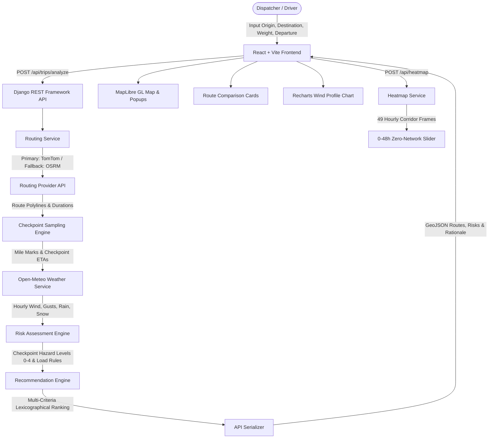

# Weather-Aware Commercial Truck Routing

[](https://github.com/akash93229/weather-aware-truck-routing-/actions/workflows/ci.yml)
*(Note: status badge currently tracks `?branch=ui-redesign`; switch query to `?branch=main` after merging into main)*

A production-grade commercial truck routing and weather hazard intelligence platform that evaluates up to three distinct route corridors against real-time hourly forecasts and gross truck load weight constraints to recommend the safest path.

- **Live app**: *(coming soon)*
- **Loom walkthrough**: *(coming soon)*

---

## 2. Features

- **Up to 3 Distinct Routes**: Evaluates Fastest, Alternative 1, and Alternative 2 corridors computed using commercial truck attributes and automatic lateral waypoint expansion when needed.
- **Weather at Checkpoint ETA**: Samples route polylines at regular mile intervals (10, 25, 50, or Auto) and retrieves forecasts (sustained wind at 10m, wind gusts, rain rate, and snow rate) matched to each checkpoint's estimated time of arrival.
- **Load-Aware Risk Assessment (Levels 0–4)**: Evaluates hazard levels (0: Low, 1: Moderate, 2: High, 3: Severe, 4: No Travel) adjusted dynamically based on truck cargo weight (e.g. empty vs 40k+ lb trailers).
- **Plain-English Recommendation Rationale**: Compares alternatives against the fastest baseline using multi-criteria ranking, explaining safety tradeoffs and minute deltas in plain English.
- **Interactive Checkpoint Popups**: Clicking any checkpoint on the map reveals its exact mile marker, ETA in local and UTC time, weather conditions, primary hazard drivers, and applicable load rules.
- **0–48 Hour Corridor Heatmap Slider**: 49 hourly weather hazard frames pre-fetched in a single request and scrubbed locally via `requestAnimationFrame` with zero additional network requests.
- **Risk & Wind Profile Chart**: Elevation profile and sustained wind speeds plotted across cumulative mileage with checkpoint risk color indicators.
- **Demo Scenarios & Live Forecasts**: Pre-configured storm simulation preset (Chicago to Dallas) alongside live real-time Open-Meteo forecasts.
- **Loading & Error Feedback**: Informative loading spinners, error alerts with retry guidance, and automatic fallback notifications.
- **Responsive Mobile Layout**: Single-column and stacked panel layouts tailored for desktop (1920px, 1440px), laptop/tablet (1280px, 1024px), and mobile (390px) viewports.
- **Route Colour Legend**: Direct visual parity between map line colors and route card headers (Fastest: Sky Blue, Alternative 1: Purple, Alternative 2: Orange) paired with textual labels.
- **Stale-Result Notification**: Form modifications dim existing results and display an "Inputs changed. Press Analyze to update" notice banner; clearing origin or destination resets the route display.
- **Map Attribution**: Unobtrusive attribution acknowledging Open-Meteo, OpenStreetMap contributors, CARTO, and TomTom.

---

## 3. Architecture



### Module Responsibilities

| File Path | Responsibility |
| :--- | :--- |
| [backend/trips/api/views.py](backend/trips/api/views.py) | API view endpoints for trip analysis, heatmap frames, geocoding, and health checks |
| [backend/trips/services/routing/service.py](backend/trips/services/routing/service.py) | High-level routing orchestrator: TomTom primary, OSRM fallback, deduplication, and lateral via-points |
| [backend/trips/services/routing/tomtom.py](backend/trips/services/routing/tomtom.py) | TomTom Routing API integration for commercial truck routes and polyline coordinates |
| [backend/trips/services/routing/osrm.py](backend/trips/services/routing/osrm.py) | Keyless OSRM fallback provider with 1.15x commercial truck duration scaling |
| [backend/trips/services/routing/here.py](backend/trips/services/routing/here.py) | HERE Routing API v8 client (selectable via `ROUTING_PROVIDER=here`) |
| [backend/trips/services/weather/open_meteo.py](backend/trips/services/weather/open_meteo.py) | Batched Open-Meteo forecast client with 30-minute coordinate caching |
| [backend/trips/services/weather/fixture.py](backend/trips/services/weather/fixture.py) | Deterministic storm simulation weather fixture for reproducible demonstrations |
| [backend/trips/services/checkpoints.py](backend/trips/services/checkpoints.py) | Checkpoint generation, ETA calculation, and 1D Voronoi corridor mile attribution |
| [backend/trips/services/risk.py](backend/trips/services/risk.py) | Weather risk evaluation (0–4), edge threshold comparisons, and load-dependent rules |
| [backend/trips/services/recommend.py](backend/trips/services/recommend.py) | Route risk aggregation, lexicographical multi-criteria ranking, and plain-English rationale |
| [backend/trips/services/heatmap.py](backend/trips/services/heatmap.py) | Generates 49 hourly corridor bounding-box frames (hours 0–48) for local animation |
| [backend/trips/services/geocoding.py](backend/trips/services/geocoding.py) | Nominatim OpenStreetMap forward geocoding client with 24-hour caching |
| [frontend/src/App.jsx](frontend/src/App.jsx) | Main frontend container, managing form state, analysis requests, and stale input warnings |
| [frontend/src/components/MapView.jsx](frontend/src/components/MapView.jsx) | MapLibre GL map rendering route polylines, checkpoint circles, popups, and heatmap tiles |
| [frontend/src/components/TripForm.jsx](frontend/src/components/TripForm.jsx) | Input form handling geocoding autocompletion, departure time, weight, and scenario presets |
| [frontend/src/components/RouteCards.jsx](frontend/src/components/RouteCards.jsx) | Route summary cards displaying durations, distances, color chips, and recommendation rationale |
| [frontend/src/components/RiskProfileChart.tsx](frontend/src/components/RiskProfileChart.tsx) | Interactive Recharts elevation and sustained wind speed chart along cumulative route mileage |
| [frontend/src/components/RiskLegend.jsx](frontend/src/components/RiskLegend.jsx) | Map overlay legend displaying risk scale levels (0–4) and route line color chips |

---

## 4. Tech Stack

| Layer | Technologies Used | Description |
| :--- | :--- | :--- |
| **Frontend Framework** | React 19 + Vite | JavaScript application structure; fast ES module bundling |
| **TypeScript Components** | TypeScript (partial) | Used specifically for [RiskProfileChart.tsx](frontend/src/components/RiskProfileChart.tsx) and component types |
| **Interactive Map** | MapLibre GL JS + `react-map-gl` | Hardware-accelerated vector mapping with CARTO Dark Matter basemap |
| **Data Visualization** | Recharts | Composable SVG charting for corridor elevation and wind profile curves |
| **Styling** | Vanilla CSS Glassmorphism | Custom design tokens, dark mode palette, flexbox/grid layouts, no Tailwind/MUI dependencies |
| **Backend Framework** | Django 5+ + Django REST Framework | Python 3.12 web service handling routing, weather batching, and risk evaluation |
| **API Schema & Docs** | `drf-spectacular` | Automated OpenAPI 3.0 specification generation and interactive Swagger UI |
| **Testing & Quality** | pytest, pytest-django, Ruff, Oxlint | 110 backend unit/integration tests, 6 frontend tests, strict zero-warning linters |

*(Note: Material-UI, TanStack Query, and universal React+TypeScript claims were cleaned up to accurately reflect the real codebase architecture).*

---

## 5. Routing Provider

HERE was the first choice in the plan, but HERE developer account login/setup did not work for me, so TomTom Routing API is used as the primary provider. OSRM is the automatic fallback. HERE provider code is kept and can be enabled with `ROUTING_PROVIDER=here`.

- **Primary Provider**: TomTom Routing API (`tomtom`), configured with commercial truck vehicle profiles and live traffic considerations.
- **Automatic Fallback**: Open Source Routing Machine (`osrm_fallback`). When TomTom is unreachable or lacks coverage, the system falls back seamlessly to OSRM and applies a calibrated 1.15x duration multiplier for commercial truck travel estimation.
- **Three Distinct Corridors**: If the routing provider returns fewer than 3 distinct paths, the routing engine automatically calculates lateral via-points (offset perpendicular to the route midpoint by ±30 and ±45 miles) and queries additional paths in parallel. If geography or physical road networks do not allow 3 paths, fewer routes are returned with an explanatory note.
- **Legacy Endpoint**: A legacy single-route endpoint (`/api/route/`) backed by OpenRouteService remains in [backend/trips/services/ors.py](backend/trips/services/ors.py) for backward compatibility.

---

## 6. Risk Rules & Thresholds

Weather hazard severity is evaluated against standard commercial transportation thresholds:

| Hazard Dimension | Level 0: Low | Level 1: Moderate | Level 2: High | Level 3: Severe | Level 4: No Travel |
| :--- | :--- | :--- | :--- | :--- | :--- |
| **Sustained Wind (10m)** | < 25 mph | 25 – 34.9 mph | 35 – 44.9 mph | 45 – 54.9 mph | ≥ 55 mph |
| **Rain Precipitation** | < 0.10 in/hr | 0.10 – 0.24 in/hr | 0.25 – 0.49 in/hr | 0.50 – 1.00 in/hr | > 1.00 in/hr |
| **Snow Precipitation** | < 0.50 in/hr | 0.50 – 0.99 in/hr | 1.00 – 1.99 in/hr | 2.00 – 3.00 in/hr | > 3.00 in/hr |

### Edge & Boundary Rules
- **Lower bound inclusive**: E.g., wind 25.0 mph is Moderate; wind 35.0 mph is High; wind 45.0 mph is Severe; wind 55.0 mph is No Travel.
- **Upper bound inclusiveness on Severe rain/snow**: Exactly 1.00 in/hr of rain is Severe (exceeding 1.00 is No Travel); exactly 3.00 in/hr of snow is Severe (exceeding 3.00 is No Travel).

### Load-Aware Weight Rules
Truck cargo weight dynamically alters wind sensitivity (load comparisons use strict `>`):
1. **Any Load**: Sustained wind ≥ 55 mph triggers **No Travel** regardless of truck weight.
2. **Heavy Load in Gale Winds**: Sustained wind 45–54 mph and cargo weight > 30,000 lb triggers **No Travel**.
3. **Heavy Load in Strong Winds**: Sustained wind 35–44 mph and cargo weight > 40,000 lb triggers at least **Severe** risk.

### Composite Checkpoint Risk
The overall risk score for each checkpoint is computed as the maximum risk level among adjusted wind, rain, and snow:
$$\text{Risk}_{\text{checkpoint}} = \max(\text{Wind}_{\text{adjusted}}, \text{Rain}, \text{Snow})$$

---

## 7. Recommendation Ranking Order

Routes are evaluated and sorted using a deterministic lexicographical tuple (smaller values rank higher):

$$\text{Key} = (\text{has\_no\_travel}, \text{miles}_{\text{no\_travel}}, \text{miles}_{\text{severe}}, \text{miles}_{\text{high}}, \text{average\_risk}, \text{duration\_seconds})$$

1. **Safety First**: Any route with zero No Travel zones outranks routes containing No Travel checkpoints.
2. **Minimize Hazard Exposure**: Ranks lowest miles in No Travel, then lowest miles in Severe, followed by lowest miles in High.
3. **Minimize Average Risk**: Prefers lower corridor-weighted average risk score.
4. **Efficiency Tie-Breaker**: Faster travel duration breaks ties between routes with identical hazard profiles.
5. **No Safe Route Condition**: If every available route contains No Travel checkpoints, no route is recommended, and the system issues the rationale: *"No safe route at this departure time. No route recommended: all available routes exceed safety limits with No Travel conditions."*

---

## 8. Engineering Assumptions

| Dimension | Real Value in Code | Source Reference |
| :--- | :--- | :--- |
| **Wind Metric** | Sustained wind at 10m height (`wind_speed_10m`); gusts (`wind_gusts_10m`) shown in popups | [backend/trips/services/weather/open_meteo.py](backend/trips/services/weather/open_meteo.py) |
| **Boundary Inclusiveness** | Lower bound inclusive; exact upper bounds 1.00 in/hr rain and 3.00 in/hr snow are Severe | [backend/trips/services/risk.py](backend/trips/services/risk.py) |
| **Checkpoint Spacing** | 10, 25, or 50 miles, or Auto: `<150 mi: 10`, `<600 mi: 25`, `else: 50` | [frontend/src/components/TripForm.jsx](frontend/src/components/TripForm.jsx) |
| **Corridor Attribution** | 1D Voronoi ownership: mile attribution extends halfway to neighboring checkpoints | [backend/trips/services/checkpoints.py](backend/trips/services/checkpoints.py) |
| **ETA Forecast Matching** | Nearest forecast hour to checkpoint ETA; converted and computed in UTC | [backend/trips/services/checkpoints.py](backend/trips/services/checkpoints.py) |
| **Forecast Horizon** | 16-day Open-Meteo forecast horizon; departures beyond 16 days display a warning | [backend/trips/services/weather/open_meteo.py](backend/trips/services/weather/open_meteo.py) |
| **Heatmap Animation** | Hour 0 = departure time; 49 sequential hourly frames (0 to 48) generated via `/api/heatmap/` | [backend/trips/services/heatmap.py](backend/trips/services/heatmap.py) |
| **OSRM Scale Factor** | 1.15x duration multiplier applied to OSRM passenger routing for commercial truck estimation | [backend/trips/services/routing/osrm.py](backend/trips/services/routing/osrm.py) |
| **Blocked Routes** | Routes with No Travel conditions rank last and are never recommended | [backend/trips/services/recommend.py](backend/trips/services/recommend.py) |
| **Cargo Load Limits** | Validated between 1 lb and 80,000 lb (gross federal commercial vehicle limit) | [frontend/src/components/TripForm.jsx](frontend/src/components/TripForm.jsx) |
| **Routing Cache TTL** | 15 minutes (900 seconds) keyed by origin, destination, and load weight | [backend/trips/services/routing/service.py](backend/trips/services/routing/service.py) |
| **Weather Cache TTL** | 30 minutes (1800 seconds) keyed by rounded lat/lng and date range | [backend/trips/services/weather/open_meteo.py](backend/trips/services/weather/open_meteo.py) |
| **Geocoding Cache TTL** | 24 hours (86400 seconds) keyed by normalized address string | [backend/trips/services/geocoding.py](backend/trips/services/geocoding.py) |

---

## 9. API Summary

All endpoints are registered under `/api/` in [backend/trips/api/urls.py](backend/trips/api/urls.py):

- **`GET /api/health/`**: Health check probe returning API status, active routing provider, and service readiness.
- **`GET /api/geocode/?q=<query>`**: Forward geocoding of city, state, or address string with 24-hour cache.
- **`POST /api/trips/analyze/`**: Core trip analysis evaluating up to 3 routes, checkpoint weather, risk scores, and recommendation.
- **`POST /api/heatmap/`**: Generates 49 hourly corridor weather hazard animation frames (hours 0–48) using cached route geometry.
- **`POST /api/route/`**: Legacy single-route generation endpoint backed by OpenRouteService (kept for backward compatibility).
- **`GET /api/schema/`**: OpenAPI 3.0 specification download endpoint in YAML/JSON format generated via `drf-spectacular`.
- **`GET /api/docs/`**: Interactive Swagger UI documentation providing request schemas and interactive testing.

---

## 10. Local Setup & Execution

### Prerequisites
- Python 3.12+
- Node.js 20+ and npm

### Environment Variables
Configure the environment variables listed below in `backend/.env` and `frontend/.env` (refer to `.env.example` templates; never commit secret keys):

- **Backend (`backend/.env`)**:
  - `DJANGO_SECRET_KEY`
  - `DJANGO_DEBUG`
  - `DJANGO_ALLOWED_HOSTS`
  - `CORS_ALLOWED_ORIGINS`
  - `TOMTOM_API_KEY`
  - `ROUTING_PROVIDER`
  - `HERE_API_KEY`
  - `ORS_API_KEY`
  - `ORS_BASE_URL`
- **Frontend (`frontend/.env`)**:
  - `VITE_API_BASE_URL`
  - `VITE_API_URL`

### Windows (PowerShell)

```powershell
# 1. Backend Setup
cd backend
python -m venv .venv
.\.venv\Scripts\Activate.ps1
pip install -r requirements.txt
Copy-Item .env.example .env
# Edit .env with your TOMTOM_API_KEY and DJANGO_SECRET_KEY
python manage.py migrate
python manage.py runserver 8000

# 2. Frontend Setup (in a separate terminal)
cd frontend
npm install
Copy-Item .env.example .env
npm run dev
```

### macOS / Linux (Bash)

```bash
# 1. Backend Setup
cd backend
python3 -m venv .venv
source .venv/bin/activate
pip install -r requirements.txt
cp .env.example .env
# Edit .env with your TOMTOM_API_KEY and DJANGO_SECRET_KEY
python manage.py migrate
python manage.py runserver 8000

# 2. Frontend Setup (in a separate terminal)
cd frontend
npm install
cp .env.example .env
npm run dev
```

The application will be available at `http://localhost:5173/` with the Django API backend at `http://127.0.0.1:8000/`.

---

## 11. Testing & Code Quality

### Running Backend Tests
Execute pytest across the 110 automated backend tests:
```powershell
cd backend
.\.venv\Scripts\pytest -q
```
*Current result: 110 passed*

### Backend Linting
Verify PEP 8 compliance, imports, and syntax with Ruff:
```powershell
cd backend
.\.venv\Scripts\ruff check .
```
*Current result: All checks passed! (0 errors)*

### Frontend Linting
Execute Oxlint across frontend source files:
```powershell
cd frontend
npm run lint
```
*Current result: Found 0 warnings and 0 errors.*

### Frontend Tests
Run node unit tests for input validation and time utilities:
```powershell
cd frontend
npm test
```
*Current result: 6 passed (0 failures)*

### Frontend Production Build & Gzip Validation
Compile production assets and verify bundle budget:
```powershell
cd frontend
npm run build
```
*Current result: Main JS bundle: 1,408.70 kB raw / 395.93 kB gzip (strictly ≤ 396 kB budget).*

---

## 12. Project Status

### Completed
- [x] Multi-route generation (up to 3 routes) with TomTom primary and OSRM automatic fallback
- [x] Lateral via-point route expansion (±30, ±45 mi) when fewer than 3 distinct corridors exist
- [x] Checkpoint ETA calculation and 1D Voronoi corridor attribution
- [x] Open-Meteo hourly weather integration with batching and 30-minute caching
- [x] Load-aware risk engine (0–4) with strict threshold boundaries and cargo weight rules
- [x] Lexicographical recommendation engine with human-readable rationale
- [x] 0–48 hour weather corridor heatmap with zero-network frame scrubbing
- [x] Recharts elevation and wind speed profile visualization
- [x] Interactive MapLibre GL map with popup cards and risk scale legends
- [x] Stale results indicator banner and route reset upon clearing inputs
- [x] Direct route color chips matching map polyline styling
- [x] Responsive layout tested across 1920px, 1440px, 1280px, 1024px, and 390px viewports
- [x] Comprehensive test suite (110 backend tests, 6 frontend tests) and zero-warning linting
- [x] Automated GitHub Actions CI workflow for backend and frontend jobs

### Not Yet (Planned)
- [ ] Hosted public cloud deployment
- [ ] Recorded Loom video walkthrough

---

## 13. Attribution & Licences

- **Weather Data**: Forecasts provided by [Open-Meteo](https://open-meteo.com/) under [CC BY 4.0](https://creativecommons.org/licenses/by/4.0/) (free for non-commercial use).
- **Map Tiles & Data**: Basemap styling provided by [CARTO](https://carto.com/) Dark Matter; map data © [OpenStreetMap](https://www.openstreetmap.org/copyright) contributors.
- **Routing Data**: Commercial routing and traffic data provided by [TomTom](https://www.tomtom.com/) Routing API; fallback routing provided by [OSRM](http://project-osrm.org/).
- **Deployment Spec**: Configuration provided in [render.yaml](render.yaml) for deployment environments.
