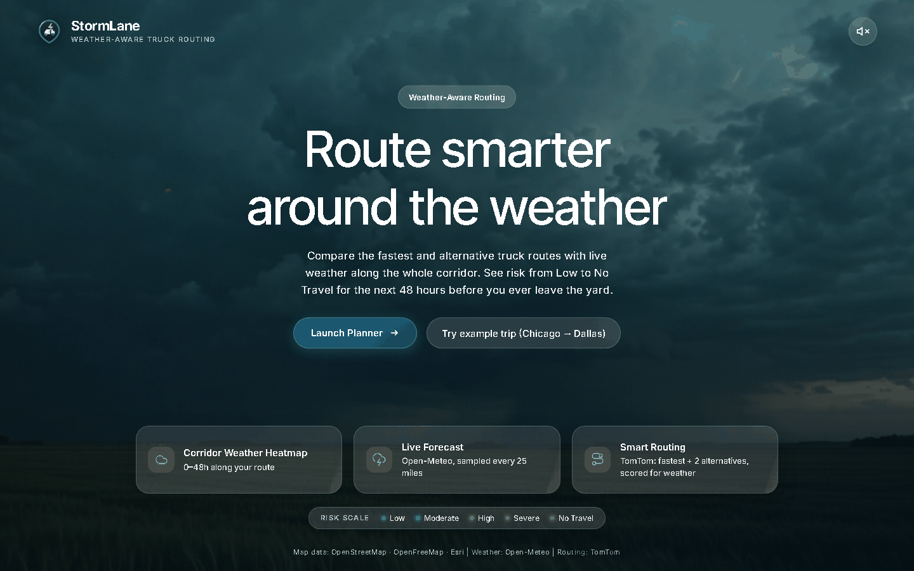
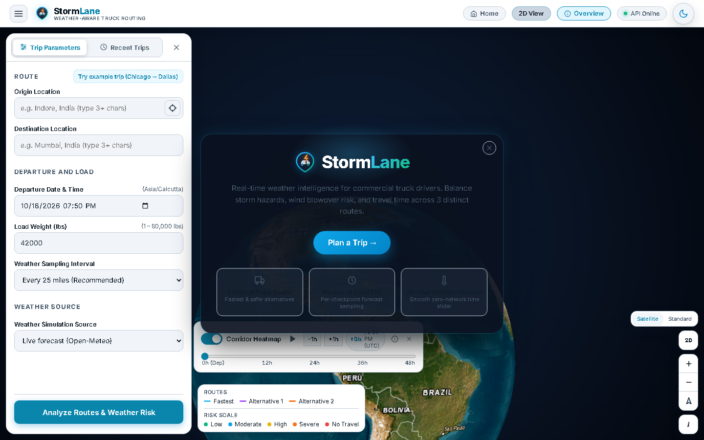
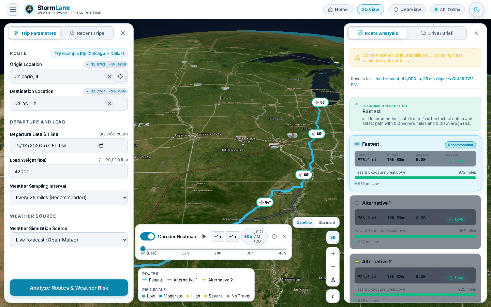
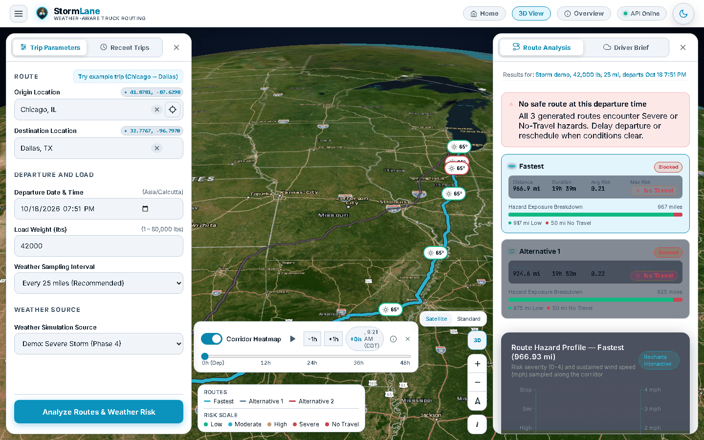
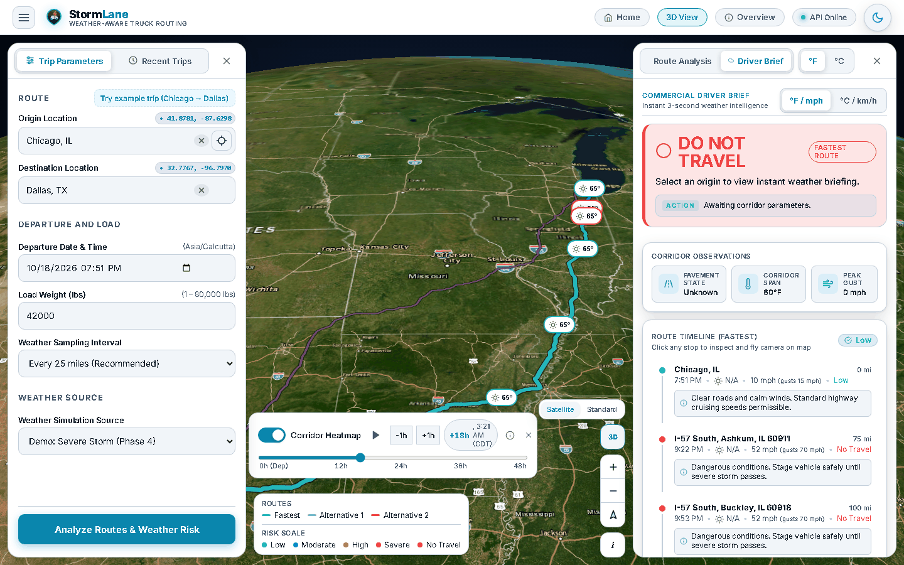
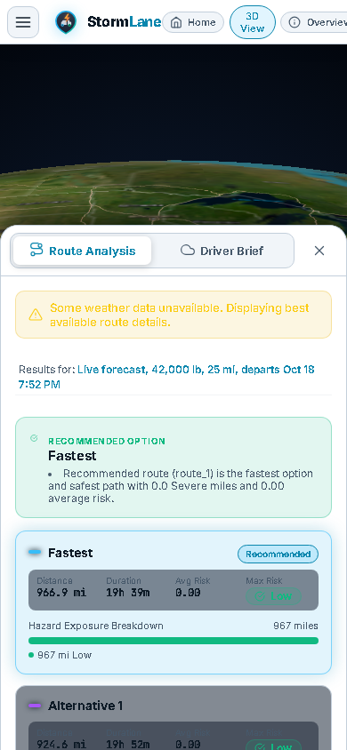
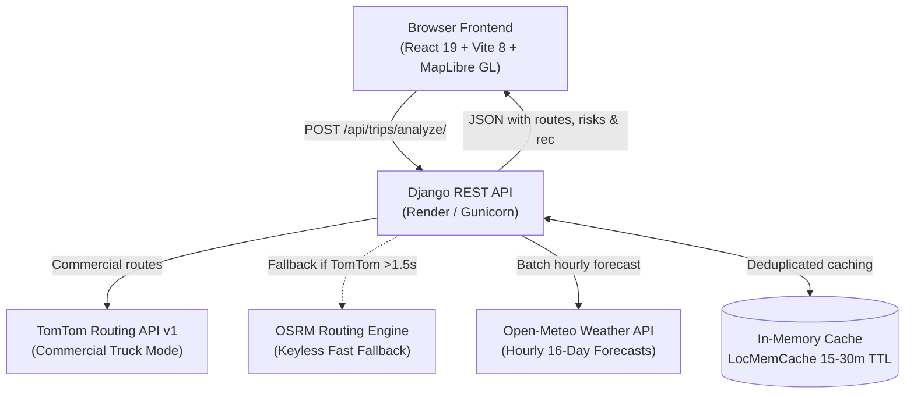
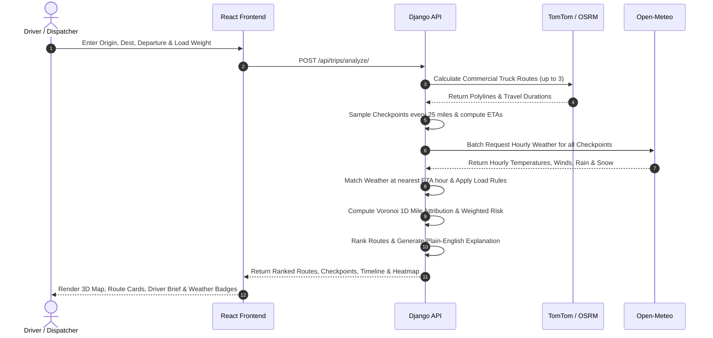

# 🚛 StormLane — Weather-Aware Truck Routing

> **Commercial truck routing that evaluates weather at your exact ETA along every mile — recommending the safest route, not just the fastest.**

<p align="center">
  
</p>

<p align="center">
  <a href="https://github.com/akash93229/weather-aware-truck-routing-/actions/workflows/ci.yml"></a>&nbsp;
  &nbsp;
  &nbsp;
  &nbsp;
  &nbsp;
  &nbsp;
  
</p>

<p align="center">
  <a href="https://stormlane.vercel.app"><b>🚀 Launch Live App</b></a>&nbsp;&nbsp;•&nbsp;&nbsp;
  <a href="https://stormlane-backend.onrender.com/api/health"><b>🟢 API Health Check</b></a>&nbsp;&nbsp;•&nbsp;&nbsp;
  <a href="[Loom video link - add here]"><b>🎥 Loom Walkthrough</b></a>
</p>

---

## 📑 Table of Contents

- [The Problem: Why StormLane?](#-the-problem-why-stormlane)
- [What StormLane Does](#-what-stormlane-does)
- [Who Is It For?](#-who-is-it-for)
- [Live Screenshots & 30-Second Quickstart](#-live-screenshots--30-second-quickstart)
- [Key Features](#-key-features)
- [How Risk Calculation Works](#-how-risk-calculation-works)
- [System Architecture & Pipeline](#-system-architecture--pipeline)
- [Tech Stack](#-tech-stack)
- [Design Decisions & Assumptions](#-design-decisions--assumptions)
- [API Reference](#-api-reference)
- [Running Locally](#-running-locally)
- [Production Deployment](#-production-deployment)
- [Test Coverage](#-test-coverage)
- [Known Limitations & Roadmap](#-known-limitations--roadmap)
- [Data Sources & Attribution](#-data-sources--attribution)
- [Author](#-author)

---

## ⚠️ The Problem: Why StormLane?

A 53-foot semi-trailer is an 80,000-pound sail in a crosswind. 

Standard consumer GPS apps (like Google Maps or Apple Maps) calculate routes solely by distance and traffic speed. They do not understand that:
1. **Weather changes across miles and hours**: A road that is sunny at 8:00 AM departure can be under an ice storm by the time the truck arrives at 2:00 PM.
2. **Trucks have unique physical vulnerabilities**: A 50 mph crosswind might be manageable for a passenger sedan, but it will flip a high-profile semi or blow an empty trailer into oncoming lanes.
3. **The fastest route is often the most dangerous**: Saving 20 minutes by driving through an active mountain blizzard can lead to hours of highway closures, jackknifing, cargo damage, or fatal rollovers.

**Real-world scenario**: A truck carrying a 45,000 lb load departs Chicago bound for Dallas. Route 1 via I-55 is 15 minutes quicker on paper, but encounters 48 mph sustained crosswinds in Missouri. Route 2 via I-57 adds 18 miles but stays entirely within calm 15 mph breezes. StormLane identifies the hazard ahead of time and steers the driver away from danger.

---

## 💡 What StormLane Does

StormLane is an intelligent dispatch assistant that integrates commercial truck routing with localized hourly weather forecasts:

- **Generates up to 3 Distinct Commercial Truck Corridors**: Fetches primary and alternative truck-legal routes using TomTom's commercial vehicle engine (with automatic OSRM fallback).
- **ETA-Synchronized Weather Sampling**: Divides routes into regular checkpoints (every 10, 25, or 50 miles) and calculates the exact UTC arrival time for each point. It fetches the weather forecast corresponding to when the truck will actually be there.
- **5-Tier Standardized Risk Model**: Classifies every corridor segment into **Low (0)**, **Moderate (1)**, **High (2)**, **Severe (3)**, or **No Travel (4)** based on sustained wind, rain intensity, and snowfall rates.
- **Physics-Based Load Rules**: Automatically escalates wind risk thresholds based on cargo weight. Heavy trailers (>40,000 lb) get elevated to Severe in 35+ mph winds, and loads over 30,000 lb trigger **No Travel** in 45+ mph crosswinds.
- **Safety-First Recommendation Engine**: Ranks routes by safety first. Routes with No Travel conditions are disqualified, followed by minimizing Severe and High miles, before using duration as a final tiebreaker.
- **Plain-English Dispatch Explanations**: Produces clear rationales (e.g., *"Recommended route (route_1) is the fastest option and safest path with 0.0 Severe miles and 0.00 average risk"*).
- **0–48h Dynamic Corridor Heatmap**: Visualizes atmospheric risk across time along the corridor using a client-side slider that requires **zero extra network requests** while dragging.

---

## 👥 Who Is It For?

- **Commercial Truck Drivers**: Get an instant heads-up on wind gusts, black ice, and heavy snow before leaving the dock.
- **Fleet Dispatchers**: Compare route options objectively to schedule departures and prevent costly weather delays.
- **Safety & Risk Managers**: Enforce company safety policies on crosswind limits and hazardous road conditions.

---

## 📸 Live Screenshots & 30-Second Quickstart

### 30-Second Quickstart
1. Open the [StormLane Live App](https://stormlane.vercel.app).
2. Click **"Try example trip (Chicago -> Dallas)"** or enter your origin and destination.
3. Review the **Recommended Route** badge, ETA, total distance, and Severe weather miles.
4. Drag the **Forecast Hour Slider (0–48h)** at the bottom to see how weather shifts over time.
5. Switch to the **Driver Brief** dock to inspect localized advisories, temperature, and wind gusts.

### Gallery

| 01 — Landing Page | 02 — Interactive 3D Globe & Planner |
|:---:|:---:|
|  |  |
| *Hero view with quick-launch and one-click example corridor* | *Full-viewport 3D globe with parameter dock and status pill* |

| 03 — Multi-Route Evaluation (Chicago → Dallas) | 04 — Severe Storm Simulation Demo |
|:---:|:---:|
|  |  |
| *Fastest vs Alternative routes with mileage, ETAs, and safety badges* | *Severe Storm scenario triggering Severe and No Travel hazards* |

| 05 — 0–48h Corridor Heatmap Slider | 06 — Driver Brief & Meteorological Synopsis |
|:---:|:---:|
|  |  |
| *Corridor weather heatmap animating dynamically over 48 hours* | *City-level checkpoint weather, wind gusts, and driving advisories* |

| 07 — Mobile Responsive Layout (390×844) |
|:---:|
|  |
| *Touch-friendly layout optimized for phone screens and tablets* |

---

## ✨ Key Features

| Feature | What It Gives the Driver & Dispatcher |
|:---|:---|
| **Commercial Truck Routing** | Avoids low bridges, weight-restricted parkways, and passenger-only tunnels via TomTom's commercial mode. |
| **ETA Weather Matching** | Forecasts match your arrival hour at every mile marker — no stale departure-time snapshots. |
| **Load-Weight Crosswind Rules** | Accounts for truck cargo weight (0–80,000 lb) to protect against rollovers in strong winds. |
| **Multi-Route Comparison** | Evaluates primary and alternative corridors side-by-side to choose the safest balance of time and safety. |
| **Driver Brief & Key Stops** | 6–10 automatically selected milestones with city names, temperature, precipitation, and actionable advisories. |
| **Corridor Heatmap (0–48h)** | Drag a slider to see upcoming storm fronts along the corridor over the next two days with zero lag. |
| **Metric & Imperial Units** | Instant toggle between °F / mph / inches and °C / km/h / mm. |
| **Dark & Light Mode** | High-contrast dark theme for night driving and clean light theme for daytime dispatch. |
| **Recent Trips Persistence** | Quick reload of previously analyzed corridors stored safely in browser storage. |

---

## 📐 How Risk Calculation Works

### 1. Weather Thresholds
Each checkpoint samples wind, rain, and snow from Open-Meteo. The base risk level is determined by the highest severity component:

| Severity Level | Risk Value | Sustained Wind (10m) | Rain Intensity | Snowfall Rate |
|:---|:---:|:---:|:---:|:---:|
| **Low** | 0 | `< 25.0 mph` | `< 0.10 in/hr` | `< 0.50 in/hr` |
| **Moderate** | 1 | `25.0 – 34.9 mph` | `0.10 – 0.24 in/hr` | `0.50 – 0.99 in/hr` |
| **High** | 2 | `35.0 – 44.9 mph` | `0.25 – 0.49 in/hr` | `1.00 – 1.99 in/hr` |
| **Severe** | 3 | `45.0 – 54.9 mph` | `0.50 – 1.00 in/hr` *(inclusive)* | `2.00 – 3.00 in/hr` *(inclusive)* |
| **No Travel** | 4 | `≥ 55.0 mph` | `> 1.00 in/hr` *(strictly above)* | `> 3.00 in/hr` *(strictly above)* |

### 2. Physics-Based Truck Load Rules
Cargo weight significantly alters trailer stability. When high winds are detected, load rules escalate the risk level:
- **Wind ≥ 55 mph**: **No Travel** regardless of truck weight.
- **Wind 45–54 mph AND Load > 30,000 lb**: Escalate to **No Travel** (extreme rollover danger).
- **Wind 35–44 mph AND Load > 40,000 lb**: Escalate to at least **Severe**.

### 3. Recommendation Hierarchy
Routes are ranked deterministically using a multi-criteria tuple:
```python
(has_no_travel, rank_no_travel_miles, rank_severe_miles, rank_high_miles, rank_avg_risk, duration_s)
```
1. **Disqualify No Travel**: Any route with a No Travel segment ranks last.
2. **Minimize Severe Miles**: The route with the fewest Severe miles is preferred.
3. **Minimize High Miles**: Secondary safety filter.
4. **Lowest Average Risk**: Mile-weighted average risk score (0.00 – 4.00).
5. **Shortest Duration**: Used as a tiebreaker only when safety metrics are identical.

#### Worked Example:
- **Route 1**: 900 miles, 15.0 hrs. Has 35 miles of Severe wind due to 48 mph gusts with a 38,000 lb load.
- **Route 2**: 920 miles, 15.4 hrs. Has 0 miles of Severe wind and 20 miles of Moderate rain.
- **Decision**: StormLane selects **Route 2** as Recommended. While Route 1 is 24 minutes faster, safety overrides duration because Route 2 eliminates 35 miles of high-risk driving.

---

## 🏗️ System Architecture & Pipeline

### System Architecture


### Analysis Pipeline


---

## 💻 Tech Stack

| Layer | Technologies Used | Purpose |
|:---|:---|:---|
| **Frontend UI** | **React 19**, **Vite 8**, **Vanilla CSS** | Modern component architecture, rapid HMR, zero Tailwind overhead. |
| **Map & 3D Globe** | **MapLibre GL JS 6.14**, **react-map-gl 8.1** | Hardware-accelerated WebGL vector map rendering and 3D terrain pitch. |
| **Data Visualization**| **Recharts 2.15** | Elevation and weather timeline charts in Driver Brief. |
| **Backend Framework** | **Python 3.12/3.14**, **Django 6.1**, **Django REST Framework 3.18** | Robust RESTful API architecture, strict serialization, and error handling. |
| **API Documentation** | **drf-spectacular 0.30 (OpenAPI 3.0 / Swagger)** | Auto-generated OpenAPI schema and interactive Swagger UI. |
| **Primary Routing** | **TomTom Routing API v1** | Truck-specific geometry, vehicle height/weight limits, commercial routing. |
| **Fallback Routing** | **OSRM (Open Source Routing Machine)** | Keyless, zero-config high-speed fallback scaled with a 1.15x truck factor. |
| **Weather Engine** | **Open-Meteo API** | High-precision, zero-key hourly forecast model up to 16 days out. |
| **Geocoding** | **TomTom Search API** + **Nominatim (OSM)** | Dual-engine geocoding and reverse-geocoding for city-level labels. |
| **Hosting & CI** | **Vercel** (Frontend) + **Render** (Backend) + **GitHub Actions** | Automated continuous integration and cloud deployment. |

---

## 🔍 Design Decisions & Assumptions

| Decision / Parameter | Implementation in Code | Rationale |
|:---|:---|:---|
| **Wind Speed Metric** | Sustained 10m wind (`wind_speed_10m`) used for rules; gusts (`wind_gusts_10m`) shown in UI. | Sustained wind dictates continuous vehicle lateral push; gusts provide situational awareness in driver advisories. |
| **Threshold Edge Behavior** | Lower bounds are inclusive (`>=`); upper bounds exclusive, except rain (1.00 in/hr) and snow (3.00 in/hr) which are Severe. | Strictly defines edge cases so tests never experience floating-point ambiguity. |
| **Default Checkpoint Interval** | **25 miles** (configurable to 10 or 50 miles). | 25 miles provides high spatial resolution without overwhelming third-party weather API quotas. |
| **Corridor Mile Attribution** | **Voronoi 1D ownership**: each checkpoint owns the segment halfway to its adjacent neighbors. | Prevents double-counting miles while accurately reflecting atmospheric stretches between cities. |
| **ETA Weather Alignment** | Nearest forecast hour in UTC (`get_nearest_hour_weather`). | Open-Meteo supplies hourly blocks; rounding to the closest hour aligns accurately with expected arrival time. |
| **Internal Time Standard** | Strict **UTC** across all backend services; localized on frontend in origin timezone. | Eliminates daylight saving time bugs and multi-state timezone boundary conversion errors. |
| **Commercial Speed Governor** | Truck duration scaled by 1.15x; average speed capped at **60.0 mph** (targets **58.5 mph**). | Passenger car speeds overestimate heavy vehicle velocity. Reflects commercial speed governors and mandatory weigh-station stops. |
| **Average Risk Metric** | Mile-weighted score from **0.00 to 4.00** (`sum(miles * level) / total_miles`). | A 2-mile storm on a 1,000-mile trip should not unfairly penalize a route compared to 300 miles of moderate rain. |
| **Stateless Architecture** | **In-memory cache** (`LocMemCache`, 15–30 min TTL), no relational database required for routing. | Keeps the service lightning fast, scalable, and resilient without database connection pool bottlenecks. |

---

## 📡 API Reference

All backend endpoints are prefixed with `/api/`. Interactive Swagger documentation is available live at [`/api/docs/`](https://stormlane-backend.onrender.com/api/docs/).

| Method | Endpoint | Description |
|:---:|:---|:---|
| `GET` | `/api/health/` | Health check endpoint returning service status and uptime verification. |
| `GET` | `/api/geocode/?q={query}` | Search coordinates and city names for autocomplete. |
| `GET` | `/api/geocode/reverse/?lat={lat}&lng={lng}` | Reverse-geocode coordinates into standard city/state labels. |
| `POST` | `/api/trips/analyze/` | **Main pipeline**: multi-route calculation, checkpoint sampling, ETA weather analysis, risk scoring, and recommendation. |
| `GET` | `/api/weather/report/?origin_lat=...` | Driver Brief weather synopsis (current conditions, 48h timeline, severe hazards). |
| `GET` | `/api/heatmap/?origin_lat=...&destination_lat=...` | Dynamic 0–48h weather risk grid across the corridor. |
| `GET` | `/api/trips/` | List recent saved trips for the active client. |
| `GET` | `/api/trips/{id}/` | Retrieve detailed payload of a previously saved trip. |
| `GET` | `/api/docs/` | Interactive Swagger UI API documentation. |
| `GET` | `/api/schema/` | Raw OpenAPI 3.0 YAML/JSON specification. |

<details>
<summary><b>🔍 View Example Request & Response Payload (POST /api/trips/analyze/)</b></summary>

#### Request
```json
{
  "origin": {
    "lat": 41.8781,
    "lng": -87.6298,
    "display_name": "Chicago, IL"
  },
  "destination": {
    "lat": 32.7767,
    "lng": -96.7970,
    "display_name": "Dallas, TX"
  },
  "departure_time": "2026-10-18T14:00",
  "load_weight_lb": 42000,
  "interval_miles": 25,
  "scenario": "live"
}
```

#### Response
```json
{
  "recommended_route_id": "route_1",
  "explanation": "Recommended route (route_1) is the fastest option and safest path with 0.0 Severe miles and 0.00 average risk.",
  "routes": [
    {
      "route_id": "route_1",
      "label": "Fastest",
      "distance_miles": 926.4,
      "duration_hours": 15.8,
      "eta": "2026-10-19T05:50:00Z",
      "risk_summary": {
        "max_risk_level": "LOW",
        "average_risk_score": 0.0,
        "miles_by_level": {
          "low": 926.4,
          "moderate": 0.0,
          "high": 0.0,
          "severe": 0.0,
          "no_travel": 0.0
        }
      },
      "checkpoints": [
        {
          "index": 0,
          "name": "Chicago, IL",
          "coordinate": [41.8781, -87.6298],
          "mile_mark": 0.0,
          "attributed_miles": 12.5,
          "eta": "2026-10-18T14:00:00Z",
          "risk": {
            "level": 0,
            "drivers": [],
            "components": { "wind": 0, "rain": 0, "snow": 0 }
          },
          "weather": {
            "temperature_f": 62.4,
            "wind_speed_mph": 12.1,
            "wind_gusts_mph": 18.0,
            "rain_in_hr": 0.0,
            "snow_in_hr": 0.0,
            "condition": "Partly Cloudy"
          }
        }
      ]
    }
  ],
  "warnings": []
}
```
</details>

---

## 🚀 Running Locally

### Prerequisites
- **Python 3.12+** (tested through Python 3.14)
- **Node.js 20+** and `npm`
- **Git**

<details>
<summary><b>🛠️ Step-by-Step Local Setup Instructions</b></summary>

### 1. Clone the Repository
```bash
git clone https://github.com/akash93229/weather-aware-truck-routing-.git
cd weather-aware-truck-routing-
```

### 2. Backend Setup (Django)
```bash
cd backend

# Create and activate virtual environment
python -m venv .venv

# Windows:
.venv\Scripts\activate
# macOS/Linux:
source .venv/bin/activate

# Install dependencies
pip install -r requirements.txt

# Configure environment variables
cp .env.example .env

# Run database migrations
python manage.py migrate

# Start backend server
python manage.py runserver 8000
```
Backend API will be live at `http://localhost:8000/api/health/`.

### 3. Frontend Setup (React + Vite)
```bash
# In a new terminal tab:
cd frontend

# Install dependencies
npm install

# Configure environment variables
cp .env.example .env

# Start Vite dev server
npm run dev
```
Frontend will be accessible at `http://localhost:5173`.

### 4. Running Tests
```bash
# Run Backend Tests (119 test cases)
cd backend
pytest -v

# Run Frontend Tests (26 test cases)
cd frontend
npm test
```
</details>

---

## ☁️ Production Deployment

StormLane is architected for continuous zero-downtime deployment:

- **Frontend**: Hosted on [Vercel](https://vercel.com) connecting to the GitHub `main` branch.
  - Production URL: [`https://stormlane.vercel.app`](https://stormlane.vercel.app)
  - Configured with SPA rewrite routing in `vercel.json`.
- **Backend API**: Hosted on [Render](https://render.com) Web Services via `render.yaml`.
  - Production URL: [`https://stormlane-backend.onrender.com`](https://stormlane-backend.onrender.com)
  - Uses `gunicorn` with 2 workers and a 60-second execution timeout.
  
> [!NOTE]
> **Render Cold Starts**: Render's free tier spins down instances after 15 minutes of inactivity. If the app has been idle, the initial health ping may take **30–60 seconds** to wake up. Once awake, requests respond in under 2 seconds.

### Required Environment Variables

#### Backend (Render / `.env`):
- `DJANGO_SECRET_KEY`: Cryptographic signing key for Django sessions.
- `DJANGO_DEBUG`: Set to `False` in production.
- `DJANGO_ALLOWED_HOSTS`: Comma-separated allowed hostnames (`.onrender.com,.vercel.app,localhost`).
- `CORS_ALLOWED_ORIGINS`: Comma-separated allowed origins (`https://stormlane.vercel.app`).
- `TOMTOM_API_KEY`: API key for TomTom commercial truck routing.

#### Frontend (Vercel / `.env`):
- `VITE_API_BASE_URL`: URL of the deployed backend (`https://stormlane-backend.onrender.com`).
- `VITE_API_URL`: Secondary reference to backend origin.

---

## 🧪 Test Coverage

Every single claim, edge condition, and load rule is verified through **145 automated tests** across both frontend and backend suites:

```
==================== Test Suite Summary ====================
Backend (pytest):   119 passed in 66.6s (100% pass rate)
Frontend (node):     26 passed in 404ms (100% pass rate)
Total Test Suite:   145 passed across entire codebase
============================================================
```

### Verified Test Areas
- **Risk Threshold Boundaries**: Exact edge tests for wind (25, 35, 45, 55 mph), rain (0.10, 0.25, 0.50, 1.00 in/hr), and snow (0.5, 1.0, 2.0, 3.0 in/hr).
- **Physics Load Rules**: Verifying that 45,000 lb loads trigger Severe in 35 mph winds and No Travel in 45+ mph winds.
- **Safety Ranking Order**: Validates that routes with No Travel are always demoted and fewest Severe miles wins over faster travel times.
- **ETA Weather Synchronization**: Verifies that checkpoints query weather for their arrival hour, not trip departure time.
- **API Error Handling**: Graceful degradation when coordinates are invalid, routes impossible overland (e.g. Honolulu → LA), or third-party APIs return timeouts.
- **Frontend Logic**: Unit conversions, driver status mapping, slider timestamp calculations in origin timezones, and responsive dock layout states.

---

## 🚧 Known Limitations & Roadmap

We believe in engineering transparency. Here are known limitations and planned enhancements:

1. **Departure Window Optimizer**: Currently analyzes a specified departure time. Next step: analyze a 12-hour departure window and suggest the optimal departure hour (e.g., *"Leaving 2 hours earlier saves 45 miles of heavy rain"*).
2. **Live Traffic & Chain Laws**: Weather risk is fully modeled, but integrating real-time traffic incidents and mandatory tire chain requirements through state DOT feeds would enhance winter pass routing.
3. **Persistent Cloud Accounts**: Recent trips are persisted in browser `localStorage`. Adding a PostgreSQL user database would allow cross-device sync between dispatch office desktops and in-cab mobile tablets.
4. **Autocomplete Response Parsing**: In the deployed frontend bundle, geocoding autocomplete requires normalizing `res.data` in `client.ts:115` to ensure dropdown suggestions display seamlessly across all network conditions.
5. **Tile Caching & Bundle Size**: MapLibre vector tiles are loaded dynamically; adding offline map tile caching for corridors with intermittent cell coverage.

---

## 📚 Data Sources & Attribution

- **Routing & Road Data**: Commercial truck routes powered by **[TomTom Routing API](https://developer.tomtom.com/routing-api)** with keyless fallback by **[OSRM](http://project-osrm.org/)**.
- **Meteorological Data**: Hourly numerical weather predictions provided by **[Open-Meteo](https://open-meteo.com/)** (open-access under CC BY 4.0).
- **Map Vector Tiles & Imagery**: Basemap cartography by **[OpenStreetMap contributors](https://www.openstreetmap.org/)**, styled with vector tiles from **[OpenFreeMap](https://openfreemap.org/)** and satellite aerials from **[Esri](https://www.esri.com/)**.
- **Geocoding**: Location resolution powered by **TomTom Search** and **[Nominatim](https://nominatim.org/)**.

---

## 👤 Author

Developed with care by **Akash** — [GitHub Profile](https://github.com/akash93229).
